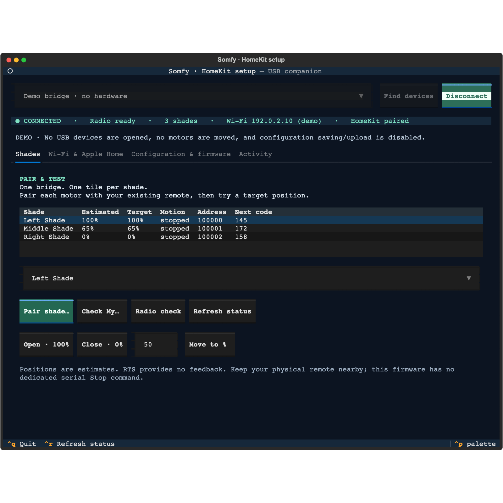
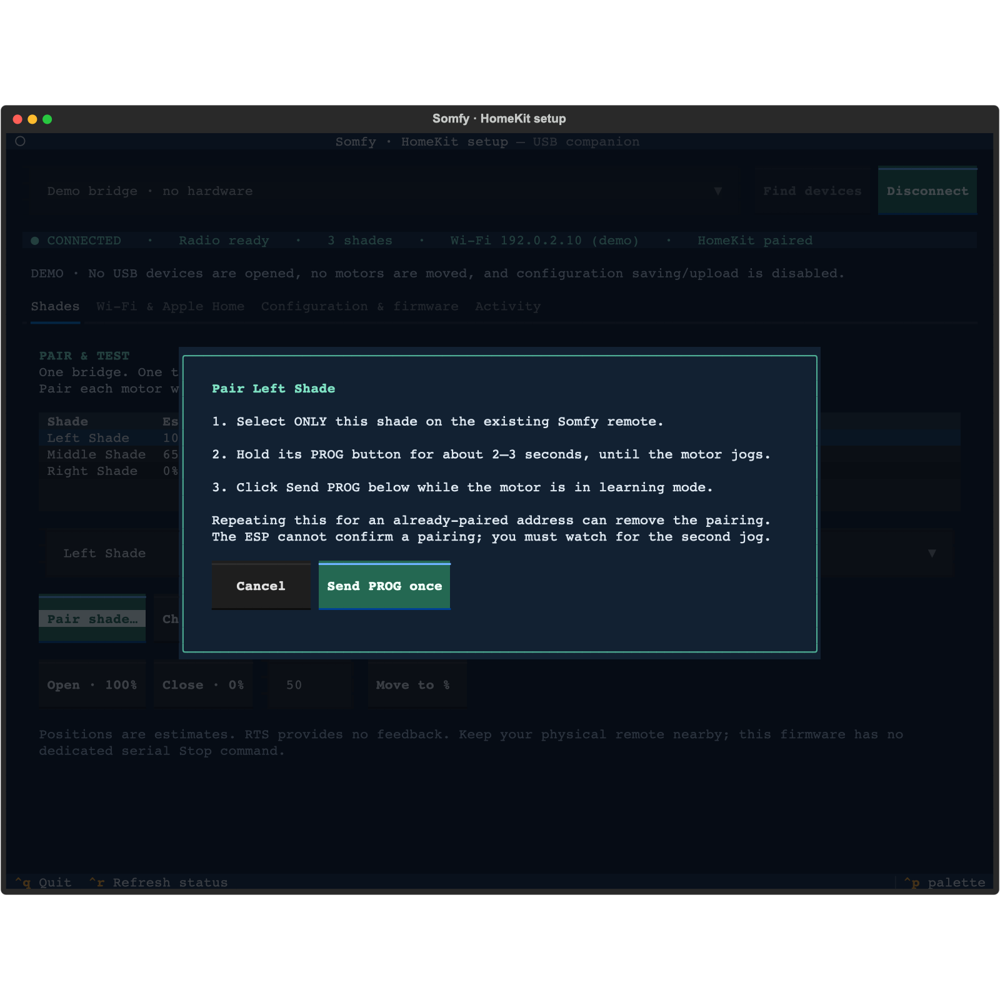
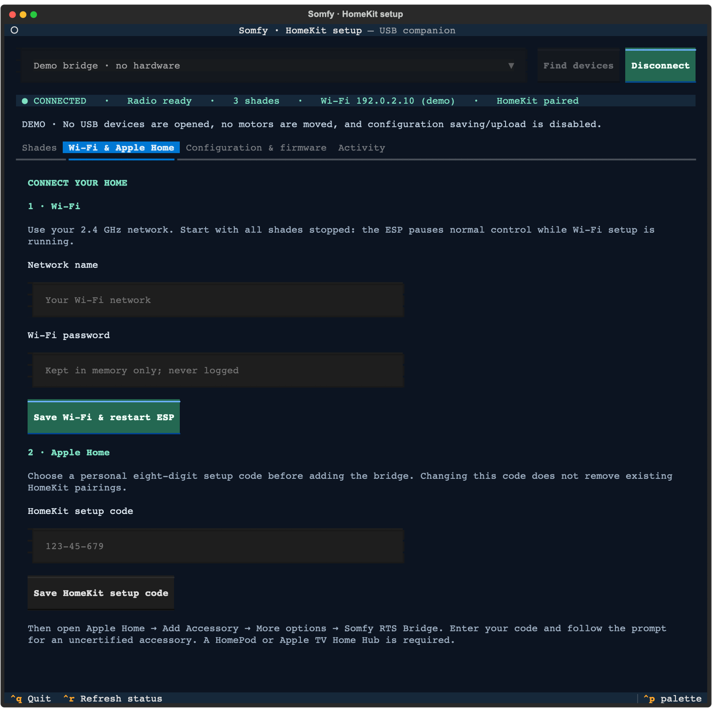
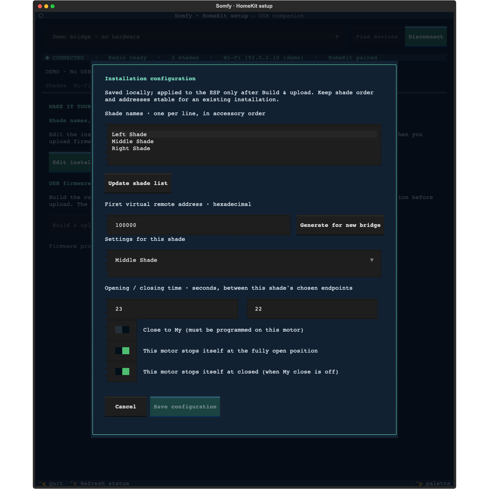

# Somfy RTS HomeKit Bridge

Control Somfy RTS roller shades from Apple Home and Siri using an ESP32-C3
and a CC1101 radio. One HomeKit bridge exposes one Window Covering tile per
shade, with open, close and percentage controls.

The reference installation controls three shades and has run reliably for
several months. Other boards and motor models need their own hardware testing.

The firmware uses native HomeKit through
[HomeSpan](https://github.com/HomeSpan/HomeSpan/tree/2.1.8).

## Features and limitations

- Transmits Somfy RTS 56-bit commands at 433.42 MHz.
- Exposes separate shade tiles behind a single HomeKit pairing.
- Estimates intermediate positions from measured opening and closing times.
- Uses each motor's programmed **My favourite as the closed position**, when
  enabled. This is enabled in the reference configuration.
- Stores rolling codes in ESP32 nonvolatile storage (NVS) before transmitting.
- Provides serial setup, motor pairing, radio diagnostics and position logging.
- Includes a local terminal app with guided setup, forms and USB firmware upload.

RTS is one-way: the motor does not acknowledge commands or report position.
Using another remote, losing an RF command or rebooting during travel can
leave the displayed position out of sync. The firmware does not receive RF,
detect obstacles or implement tilt control. Updates use USB; OTA is not enabled.

## Hardware

| Part | Requirements | Purchase link |
| --- | --- | --- |
| ESP controller | ESP32-C3 SuperMini (HW-466AB), 4 MB flash | [ESP controllers on Amazon](https://link.amazon/B07y2Re5L) |
| Radio transmitter | CC1101 module suitable for 433 MHz, with an antenna | [Radio transmitter on Amazon](https://link.amazon/B02TUnFFw) |
| Jumper wires | Short leads for power, SPI and GDO0 | [Wires on Amazon](https://link.amazon/B0h8Fonvl) |
| USB cable | USB data cable suitable for your board | |

The Amazon links above are affiliate links. As an Amazon Associate I earn
from qualifying purchases.

You also need Somfy RTS roller shades, an existing paired remote with a PROG
button, a 2.4 GHz Wi-Fi network, and an Apple Home Hub (HomePod or Apple TV).
Somfy io-homecontrol motors use a different protocol and are unsupported.
[HomeSpan does not support operation without a Home Hub](https://github.com/HomeSpan/HomeSpan/blob/2.1.8/README.md#requirements).

Disconnect power before wiring. **Power the CC1101 from 3.3 V, never 5 V.**
Match labels on your module; physical pin order varies.

| CC1101 | ESP32-C3 SuperMini |
| --- | --- |
| VCC | 3V3 |
| GND | GND |
| SCK / SCLK | GPIO4 |
| MISO / SO / GDO1 | GPIO5 |
| MOSI / SI | GPIO6 |
| CSN / CS / SS | GPIO7 |
| GDO0 | GPIO10 |
| GDO2 | Unconnected; receive is not implemented |

Use short SPI wires and fit the module's 433 MHz antenna. Pin assignments
can be changed in the configuration.

## Terminal setup app

The local TUI connects to the ESP over USB serial. Select your device, fill
in the setup forms, and follow the pairing wizard. It works with the existing
firmware and provides shade controls, radio diagnostics, configuration editing
and firmware upload. Use the mouse or Tab, arrow keys and Enter to navigate.

These screenshots show **demo mode**, which uses example data and never
opens a serial device, saves configuration or uploads firmware.



<details>
<summary>Guided motor pairing</summary>

The wizard walks you through the existing remote's PROG button and asks you
to confirm the motor's second jog.



</details>

<details>
<summary>Wi-Fi and Apple Home setup</summary>

Enter network details and a personal HomeKit setup code in masked forms.
The app handles the serial prompts and hides private output.



</details>

<details>
<summary>Installation configuration</summary>

Edit shade names and remote addresses, and set travel times and close behavior
for each shade. Build and upload when ready to apply the settings.



</details>

## Quick start

1. Clone the repository and enter it:

   ```sh
   git clone https://github.com/majgaard/esp-somfy-homekit.git
   cd esp-somfy-homekit
   ```

2. Install the build tools in a virtual environment using Python 3.13.
   See [troubleshooting](docs/bringup.md#troubleshooting) if macOS dependency
   installation crashes.

   ```sh
   python3.13 -m venv .venv
   source .venv/bin/activate
   python -m pip install -r requirements-dev.txt
   ```

   On Windows, create the environment with `py -3.13 -m venv .venv` and
   activate with `.venv/Scripts/Activate.ps1` in PowerShell.
   PlatformIO downloads the pinned board platform and libraries on first build.

3. Start the setup app:

   ```sh
   somfy-setup
   ```

   Select the ESP's USB port. The app works with the existing firmware; no
   firmware update is required just to use the TUI. Try `somfy-setup --demo`
   to explore it without connecting hardware.

4. For a new installation, open **Configuration & firmware → Edit
   installation**. Set shade names and an unused remote address range. Select
   each shade to enter its opening/closing times, My-close mode and motor
   limits, then **Build & upload**. You can upload to a blank board without
   connecting first. For an existing installation, retain its addresses and
   shade order. The editor preserves unrelated local settings such as pins.

5. Connect, then use **Wi-Fi & Apple Home** to enter network details and a
   personal setup code. The app handles serial prompts for you. After Wi-Fi
   setup the ESP restarts; find its USB port and reconnect. Add **Somfy RTS
   Bridge** in Apple Home using the code you entered.

6. In **Shades**, run **Radio check**, then use **Pair shade** for each motor.
   The wizard explains when to hold PROG on the existing remote and asks you
   to confirm the motor's second jog. Open, close and percentage buttons let
   you test each shade while watching it.

The default close mode requires every motor's My favourite to be programmed
at your chosen closed position. See [configuration details](docs/configuration.md).
The app stores installation settings in the ignored local header. Wi-Fi
passwords and setup codes are never written to local files or the activity log.
Close other serial monitors before connecting.

## Documentation

- [Terminal setup app](docs/setup-app.md)
- [Bring-up, motor pairing and troubleshooting](docs/bringup.md)
- [Configuration, calibration and preserving rolling codes](docs/configuration.md)
- [Somfy RTS protocol and radio settings](docs/protocol.md)
- [Contributing and testing](CONTRIBUTING.md)
- [Security reporting](SECURITY.md)

## Development

The protocol encoder, position model and CC1101 register driver are portable
C components. They have no Arduino or ESP-IDF dependencies and can be tested
with a C compiler and Make:

```sh
make -C test/host run
make -C test/host asan
python -m unittest discover -s test/tui -v
```

GitHub Actions runs the host tests, AddressSanitizer/UBSan and the firmware
build. The firmware pins HomeSpan 2.1.8 and pioarduino 55.03.311
(Arduino-ESP32 3.3.11). Keep these pins when reproducing a build.

| Path | Purpose |
| --- | --- |
| `components/somfy_rts` | Frame encoding/decoding and OOK pulse generation |
| `components/shade_ctl` | Time-based position estimates and HomeKit conversion |
| `components/cc1101` | Radio configuration through an injected SPI/GPIO interface |
| `src/somfy_radio.cpp` | ESP32 SPI, RMT waveform output and NVS rolling codes |
| `src/main.cpp` | HomeSpan accessories and serial commands |
| `tools/somfy_setup` | Local Textual app, serial adapter and configuration editor |

## License and credits

[MIT](LICENSE). Protocol timings and framing are based on
[ESPSomfy-RTS](https://github.com/rstrouse/ESPSomfy-RTS) (Unlicense); CC1101
settings and power values follow
[SmartRC-CC1101-Driver-Lib](https://github.com/LSatan/SmartRC-CC1101-Driver-Lib)
(MIT). HomeKit support comes from HomeSpan (MIT). See
[third-party notices](THIRD_PARTY_NOTICES.md) for license texts and framework
licensing. This is an independent project, unaffiliated with Somfy or Apple.
